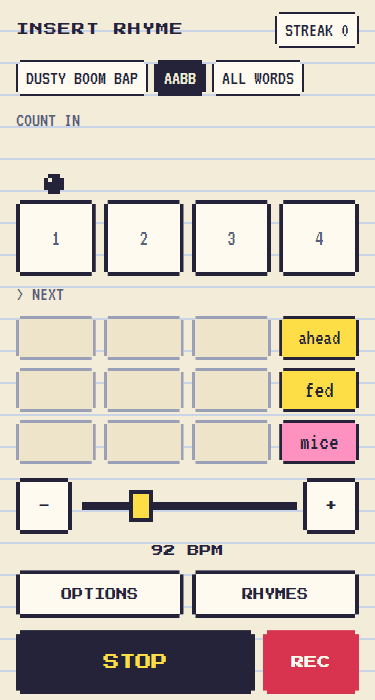

# Insert Rhyme

Free 8-bit freestyle rap practice. Pick a beat, watch the ball bounce across each bar, and land your rhymes on the bright blocks. No accounts, no ads, nothing to pay for, and nothing leaves your device.

**Play it:** https://ethanmanco.github.io/insert-rhyme/



## What it does

- **Real recorded beats**, all free-licensed (CC0 or CC BY): boom bap, laid back, jazzy, G-funk, phonk, trap and drill. Each is cut to an exact 16-bar loop. The tempo slider works like a turntable: speed and pitch move together, from 60% to 160% (slow it right down for a screwed Houston feel).
- **Use your own beat:** pick any song or beat file on your phone. The app finds its tempo and first bar by itself, and you can fix it with half, double, bar shift or tap to sync. The file never leaves your device.
- **Word themes:** 25 rap styles (crunk, Houston slab, Memphis, Chicago drill, UK drill, Brooklyn drill, UK grime, Bay Area hyphy, New Orleans bounce, Detroit, Philly, Miami bass, Midwest chopper, battle rap, conscious, horrorcore, emo rap, rage, afroswing, Jersey club and more) and 33 topics (food, cars, money, family, hustle, pirates, Halloween and more). The first word of each rhyme comes from the theme.
- **A bar view that shows exactly when to rhyme.** Each bar is a row of four blocks, one per beat. The ball lands on each block right on the beat, the target block where your rhyme should land is highlighted, and the next three bars wait underneath so you can plan.
- **6 rhyme schemes:** AABB, ABAB, AAAA, skip-line (only every other line rhymes), half-time (a rhyme every two bars) and double-time (two rhymes per bar).
- **Word prompts with three levels:** every rhyme word shown, only the first word of each rhyme shown (you find the rest), or no words (free practice with the scheme only).
- **Rhyme helper:** tap any word for its perfect and near rhymes, or type your own.
- **Tap tempo:** rapping over music from somewhere else? Tap along and the bars follow, with no built-in beat.
- **Recording:** record your verse over the beat, play it back, and download it. It stays on your device.
- **Daily streak and stats:** sessions and minutes practiced, saved in your browser.
- **Family-friendly by default.** Explicit words are behind a switch in Options, off by default. Slurs are behind a separate second switch, also off by default.

Works in portrait on a phone, with big controls. Keyboard: Space plays and stops, T taps the tempo, R records, and the arrow keys change the tempo. With reduced motion turned on in your system (or the ball switched off in Options), the bouncing ball becomes a block that lights up on each beat. Screen readers hear the next rhyme word once when each new rhyme starts, never over every beat.

## How it stays on the beat

Each loop is restarted exactly on its bar line from the audio clock, so a recording and the bar count can never drift apart, even after a tempo change. The ball never runs on its own timer either. Every frame, the app asks the audio clock where the music is (minus the delay before sound reaches your ears) and draws the ball at exactly that spot, so it cannot drift away from the beat, even after an hour. A headless browser check (`scripts/check.mjs`) plays the beat and confirms, frame by frame, that the lit block is always the beat the audio clock is on.

## How the rhyme matching works

Rhymes are found by sound, not spelling, using pronunciations from the CMU Pronouncing Dictionary. "Night" is `N AY1 T`: phonemes, with a stress number on each vowel.

- **Perfect rhymes** share the stressed vowel and everything after it, with a different sound just before it. Night, light and bite all end in `AY T`. "Knight" is left out (it sounds the same), and so is "believe" for "leave" (same sound before the vowel too, so it is an echo, not a rhyme).
- **Near rhymes** share the vowel sounds from the stressed vowel on, while the consonants differ: night, ride and time all have `AY`.
- Results are sorted by how common the word is (using the SCOWL word lists), then by how close the syllable count is.

Prompt words are dealt by rhyme sound, like cards: every sound in the dictionary with at least 8 everyday rhymes goes in a shuffled deck (a few hundred of them), and no sound comes back until the deck has been played through. Each group draws its words at random from up to 40 everyday words for its sound, leaning toward common words and skipping ones you saw recently, and the app remembers recent sounds and words between visits. Tests check that 150 groups in a row never repeat a sound and that almost every word in 60 groups is new.

Everything works offline after the first load. `scripts/build-rhymes.ts` builds the word files in `public/data` from pinned copies of the sources: the dictionary and the word lists are joined, and every word is sorted into one of three files. Everyday words go in the default file. Explicit words and slurs each get their own file, which only downloads when its switch is on.

## The explicit-word filter

The filter (`filter/`) is thorough because the pronunciation dictionary contains plenty of profanity and slurs. It catches listed words and their forms (plurals, -ed, -ing, -er, -y and so on), and a few roots that are explicit wherever they appear inside a word. An allowlist protects innocent words that happen to match, like "scatter", "spicy", "cocky" and "snigger". Every word it still flags in the common word lists was reviewed by hand.

The tests check every listed word and its forms, a set of innocent look-alikes, and every single word in the shipped default file. The word lists are stored in ROT13 so the repository does not show them as plain text.

## Credits and licenses

- **CMU Pronouncing Dictionary**, Copyright (C) 1993-2015 Carnegie Mellon University, under a BSD-style license that asks you to keep the notice. Used at commit 7479086 of [cmusphinx/cmudict](https://github.com/cmusphinx/cmudict). Full notice: [licenses/cmudict.txt](licenses/cmudict.txt), also shipped next to the data.
- **SCOWL** (Spell Checker Oriented Word Lists) 2020.12.07, Copyright 2000-2018 by Kevin Atkinson, under an MIT-like license. Used for how common each word is. Full notice: [licenses/scowl.txt](licenses/scowl.txt), also shipped next to the data.
- **List of Dirty, Naughty, Obscene, and Otherwise Bad Words** (English), (c) 2012-2020 Shutterstock, Inc., [CC BY 4.0](https://creativecommons.org/licenses/by/4.0/). Its single-word entries seed the filter, stored encoded in `filter/lists.ts`; phrases are left out.
- **Fonts:** Press Start 2P and VT323, both under the SIL Open Font License ([licenses](licenses)).
- **Beats** (each cut to a 16-bar loop; the CC BY ones are changed only by that cut):
  - [Bap Boom](https://freemusicarchive.org/music/Ketsa/the-unveiling/bap-boom/), [Jazz For The Soul](https://freemusicarchive.org/music/Ketsa/cc-by-free-to-use-for-anything/jazz-for-the-soul/), [Soul Trap](https://freemusicarchive.org/music/Ketsa/cc-by-free-to-use-for-anything/soul-trap/) and [Trench Work](https://freemusicarchive.org/music/Ketsa/cc-by-free-to-use-for-anything/trench-work/) by Ketsa ([Ketsa.uk](https://ketsa.uk)), [CC BY 4.0](https://creativecommons.org/licenses/by/4.0/)
  - [Unwind](https://freemusicarchive.org/music/holiznacc0/kick-it-laid-back-hiphop/unwind/) and [Phonk Remix](https://freemusicarchive.org/music/holiznacc0/phonk-aura-farming/phonk-remix/) by HoliznaCC0, [CC0 1.0](https://creativecommons.org/publicdomain/zero/1.0/)
  - [Will Make You Happy](https://freemusicarchive.org/music/Ketsa/cc-by-free-to-use-for-anything/will-make-you-happy/), [My Deal](https://freemusicarchive.org/music/Ketsa/cc-by-free-to-use-for-anything/my-deal/), [Importance](https://freemusicarchive.org/music/Ketsa/cc-by-free-to-use-for-anything/importance-1/), [That Feeling](https://freemusicarchive.org/music/Ketsa/cc-by-free-to-use-for-anything/that-feeling/), [The Road](https://freemusicarchive.org/music/Ketsa/cc-by-free-to-use-for-anything/the-road-1/), [All Out](https://freemusicarchive.org/music/Ketsa/cc-by-free-to-use-for-anything/all-out/), [Ease Back](https://freemusicarchive.org/music/Ketsa/cc-by-free-to-use-for-anything/ease-back/), [Dry and High](https://freemusicarchive.org/music/Ketsa/cc-by-free-to-use-for-anything/dry-and-high/), [Always Faithful](https://freemusicarchive.org/music/Ketsa/cc-by-free-to-use-for-anything/always-faithful/), [Dawn Faded](https://freemusicarchive.org/music/Ketsa/cc-by-free-to-use-for-anything/dawn-faded/), [Tide Turns](https://freemusicarchive.org/music/Ketsa/cc-by-free-to-use-for-anything/tide-turns/), [The Road 2](https://freemusicarchive.org/music/Ketsa/cc-by-free-to-use-for-anything/the-road-2/), [Soul Syrup](https://freemusicarchive.org/music/Ketsa/cc-by-free-to-use-for-anything/soul-syrup/), [Overreach](https://freemusicarchive.org/music/Ketsa/cc-by-free-to-use-for-anything/overreach/), [No Quit](https://freemusicarchive.org/music/Ketsa/cc-by-free-to-use-for-anything/no-quit/), [Vision 2](https://freemusicarchive.org/music/Ketsa/cc-by-free-to-use-for-anything/vision-2-1/), [Off Days](https://freemusicarchive.org/music/Ketsa/cc-by-free-to-use-for-anything/off-days/), [My Town](https://freemusicarchive.org/music/Ketsa/cc-by-free-to-use-for-anything/my-town/) by Ketsa ([Ketsa.uk](https://ketsa.uk)), [CC BY 4.0](https://creativecommons.org/licenses/by/4.0/)
  - [Carnival Of Souls](https://freemusicarchive.org/music/holiznacc0/beats-from-the-crypt/carnival-of-souls/) by HoliznaCC0, [CC0 1.0](https://creativecommons.org/publicdomain/zero/1.0/)
  - [Reflections](https://freemusicarchive.org/music/1000-handz/cc-by-free-to-use-melodic-rap-instrumentals/reflections-7/), [Ambition](https://freemusicarchive.org/music/1000-handz/cc-by-free-to-use-melodic-rap-instrumentals/ambition-1/), [Mercury](https://freemusicarchive.org/music/1000-handz/cc-by-free-to-use-melodic-rap-instrumentals/mercury-5/), [Pollen](https://freemusicarchive.org/music/1000-handz/cc-by-free-to-use-melodic-rap-instrumentals/pollen/), [Vanquish](https://freemusicarchive.org/music/1000-handz/cc-by-free-to-use-melodic-rap-instrumentals-vol-2/vanquish-1/), [Achilles](https://freemusicarchive.org/music/1000-handz/cc-by-free-to-use-melodic-rap-instrumentals/achilles-1/), [Recess](https://freemusicarchive.org/music/1000-handz/cc-by-free-to-use-melodic-rap-instrumentals/recess-1/), [Tension](https://freemusicarchive.org/music/1000-handz/cc-by-free-to-use-melodic-rap-instrumentals-vol-2/tension-4/), [Sahara](https://freemusicarchive.org/music/1000-handz/cc-by-free-to-use-melodic-rap-instrumentals/sahara/), [Contra](https://freemusicarchive.org/music/1000-handz/cc-by-free-to-use-melodic-rap-instrumentals/contra/), [Nectar](https://freemusicarchive.org/music/1000-handz/cc-by-free-to-use-melodic-rap-instrumentals/nectar/), [Blizzard](https://freemusicarchive.org/music/1000-handz/cc-by-free-to-use-melodic-rap-instrumentals/blizzard/), [Freedom](https://freemusicarchive.org/music/1000-handz/cc-by-free-to-use-melodic-rap-instrumentals-vol-2/freedom-11/), [White Doves](https://freemusicarchive.org/music/1000-handz/cc-by-free-to-use-melodic-rap-instrumentals-vol-2/white-doves/), [Dynamic](https://freemusicarchive.org/music/1000-handz/cc-by-free-to-use-melodic-rap-instrumentals-vol-2/dynamic/), [Kimura](https://freemusicarchive.org/music/1000-handz/cc-by-free-to-use-melodic-rap-instrumentals/kimura/), [Venom](https://freemusicarchive.org/music/1000-handz/cc-by-free-to-use-melodic-rap-instrumentals/venom-1/), [Bengal](https://freemusicarchive.org/music/1000-handz/cc-by-free-to-use-melodic-rap-instrumentals/bengal/) by 1000 Handz, [CC BY 4.0](https://creativecommons.org/licenses/by/4.0/)
  - [My Way - Hard Trap Beat](https://freesound.org/people/AudioWay/sounds/482327/), [BAG - Hard Trap Beat](https://freesound.org/people/AudioWay/sounds/482328/) by AudioByKB, [CC BY 4.0](https://creativecommons.org/licenses/by/4.0/) (Freesound preview copies)
  - [City Vibes - Trap Music](https://freemusicarchive.org/music/aurosonmusic/single/city-vibes-trap-music/) by AurosonMusic, [CC BY 4.0](https://creativecommons.org/licenses/by/4.0/)
  - [Free rap trap type beat "blame game" e](https://freemusicarchive.org/music/mohmohrap/blame-game/free-rap-trap-type-beat-blame-game-e/) by MOHMOHRAP, [CC BY 4.0](https://creativecommons.org/licenses/by/4.0/)
  - [Tei Pani](https://freesound.org/people/kontraamusic/sounds/790935/), [Black Wolf](https://freesound.org/people/kontraamusic/sounds/790952/), [Lose My Mind](https://freesound.org/people/kontraamusic/sounds/790941/), [Suicide Doors](https://freesound.org/people/kontraamusic/sounds/790947/), [Vape](https://freesound.org/people/kontraamusic/sounds/790939/), [Blue Print](https://freesound.org/people/kontraamusic/sounds/788622/), [Karma](https://freesound.org/people/kontraamusic/sounds/788432/), [Battleground](https://freesound.org/people/kontraamusic/sounds/790936/), [Seizer](https://freesound.org/people/kontraamusic/sounds/790945/), [Emergence](https://freesound.org/people/kontraamusic/sounds/788645/), [Into The Night](https://freesound.org/people/kontraamusic/sounds/790934/), [Gostorge](https://freesound.org/people/kontraamusic/sounds/788627/), [Goat](https://freesound.org/people/kontraamusic/sounds/790938/) by kontraamusic, [CC0 1.0](https://creativecommons.org/publicdomain/zero/1.0/) (Freesound preview copies)
  - [Gang$tazz](https://opengameart.org/content/gangtazz) by Alexandr Zhelanov, [CC BY 4.0](https://creativecommons.org/licenses/by/4.0/)
- **Tempo finding** for your own beats and the loop tool (`scripts/cut-loop.py`) are this project's own; the earlier code-made beats used [Steplab](https://github.com/ethanmanco/steplab)'s engine.
- One pronunciation is fixed by hand: "mic" rhymes with "like".

## Future ideas

- Video recording
- Speech recognition to check whether you actually hit the rhymes
- Sharing takes and sessions
- More beats, including grime and Houston chopped and screwed (no free-licensed ones turned up yet)
- Accounts, to keep your streak across devices

## Development

```bash
npm install
npm run dev
```

```bash
npm test
```

To rebuild the rhyme data, download the two pinned sources listed at the top of `scripts/build-rhymes.ts` into one folder, then run `node scripts/build-rhymes.ts <that folder>`.

Built with Claude Code. I designed, directed, reviewed, and tested it.
